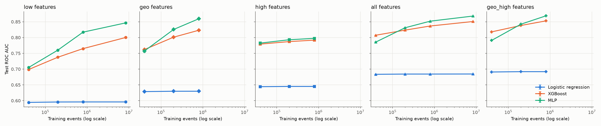

# Benchmark summary (generated by scripts/aggregate.py)

## Budget 50,000 events (3 seeds: [0, 1, 2]), test = 500k fixed events

| model | features | ROC AUC | PR AUC | ECE raw | ECE Platt | Brier | train s |
|---|---|---|---|---|---|---|---|
| stack | geo_high | 0.8232 ± 0.0001 | 0.8363 ± 0.0003 | 0.0085 ± 0.0023 | nan | 0.1713 ± 0.0000 | 5.6 ± 0.9 |
| average | geo_high | 0.8188 ± 0.0002 | 0.8314 ± 0.0001 | 0.0083 ± 0.0009 | nan | 0.1733 ± 0.0001 | 5.6 ± 0.9 |
| xgboost | geo_high | 0.8180 ± 0.0005 | 0.8322 ± 0.0005 | 0.0086 ± 0.0026 | 0.0089 ± 0.0017 | 0.1738 ± 0.0002 | 2.2 ± 0.6 |
| stack | all | 0.8109 ± 0.0005 | 0.8256 ± 0.0003 | 0.0092 ± 0.0029 | nan | 0.1771 ± 0.0003 | 4.7 ± 0.8 |
| average | all | 0.8075 ± 0.0004 | 0.8216 ± 0.0001 | 0.0099 ± 0.0029 | nan | 0.1787 ± 0.0001 | 4.7 ± 0.8 |
| xgboost | all | 0.8073 ± 0.0007 | 0.8231 ± 0.0001 | 0.0070 ± 0.0008 | 0.0094 ± 0.0023 | 0.1787 ± 0.0003 | 1.0 ± 0.1 |
| mlp | geo_high | 0.7909 ± 0.0006 | 0.7996 ± 0.0002 | 0.0609 ± 0.0005 | 0.0056 ± 0.0025 | 0.1902 ± 0.0002 | 3.4 ± 0.3 |
| mlp | all | 0.7858 ± 0.0005 | 0.7960 ± 0.0005 | 0.0520 ± 0.0066 | 0.0068 ± 0.0023 | 0.1913 ± 0.0011 | 3.7 ± 0.7 |
| average | high | 0.7847 ± 0.0016 | 0.8028 ± 0.0013 | 0.0076 ± 0.0003 | nan | 0.1883 ± 0.0007 | 4.2 ± 1.8 |
| stack | high | 0.7846 ± 0.0016 | 0.8028 ± 0.0014 | 0.0078 ± 0.0022 | nan | 0.1884 ± 0.0007 | 4.2 ± 1.8 |
| widedeep | geo_high | 0.7830 ± 0.0036 | 0.7917 ± 0.0037 | 0.0383 ± 0.0062 | 0.0051 ± 0.0007 | 0.1909 ± 0.0019 | 3.7 ± 0.1 |
| mlp | high | 0.7823 ± 0.0030 | 0.8007 ± 0.0026 | 0.0131 ± 0.0014 | 0.0077 ± 0.0031 | 0.1895 ± 0.0012 | 3.8 ± 1.8 |
| xgboost | high | 0.7791 ± 0.0007 | 0.7975 ± 0.0006 | 0.0098 ± 0.0033 | 0.0082 ± 0.0015 | 0.1907 ± 0.0002 | 0.4 ± 0.1 |
| stack | geo | 0.7745 ± 0.0015 | 0.7847 ± 0.0012 | 0.0027 ± 0.0012 | nan | 0.1923 ± 0.0006 | 5.7 ± 0.6 |
| average | geo | 0.7736 ± 0.0019 | 0.7839 ± 0.0019 | 0.0054 ± 0.0003 | nan | 0.1927 ± 0.0008 | 5.7 ± 0.6 |
| xgboost | geo | 0.7618 ± 0.0018 | 0.7736 ± 0.0022 | 0.0074 ± 0.0024 | 0.0030 ± 0.0001 | 0.1975 ± 0.0007 | 1.7 ± 0.2 |
| mlp | geo | 0.7572 ± 0.0044 | 0.7653 ± 0.0048 | 0.0552 ± 0.0135 | 0.0048 ± 0.0019 | 0.2028 ± 0.0014 | 4.0 ± 0.7 |
| average | low | 0.7150 ± 0.0016 | 0.7282 ± 0.0014 | 0.0056 ± 0.0024 | nan | 0.2139 ± 0.0005 | 5.4 ± 0.5 |
| stack | low | 0.7147 ± 0.0013 | 0.7281 ± 0.0013 | 0.0041 ± 0.0004 | nan | 0.2139 ± 0.0004 | 5.4 ± 0.5 |
| mlp | low | 0.7051 ± 0.0018 | 0.7170 ± 0.0012 | 0.0434 ± 0.0052 | 0.0036 ± 0.0015 | 0.2193 ± 0.0001 | 4.4 ± 0.4 |
| xgboost | low | 0.6986 ± 0.0011 | 0.7143 ± 0.0013 | 0.0063 ± 0.0011 | 0.0061 ± 0.0012 | 0.2189 ± 0.0004 | 1.0 ± 0.1 |
| logreg | geo_high | 0.6908 ± 0.0003 | 0.6918 ± 0.0001 | 0.0175 ± 0.0013 | 0.0169 ± 0.0008 | 0.2208 ± 0.0000 | 0.0 ± 0.0 |
| logreg | all | 0.6835 ± 0.0006 | 0.6824 ± 0.0004 | 0.0239 ± 0.0020 | 0.0231 ± 0.0016 | 0.2233 ± 0.0001 | 0.0 ± 0.0 |
| logreg | high | 0.6442 ± 0.0017 | 0.6162 ± 0.0016 | 0.0473 ± 0.0017 | 0.0470 ± 0.0025 | 0.2322 ± 0.0001 | 0.0 ± 0.0 |
| logreg | geo | 0.6287 ± 0.0004 | 0.6488 ± 0.0006 | 0.0092 ± 0.0019 | 0.0101 ± 0.0028 | 0.2360 ± 0.0000 | 0.0 ± 0.0 |
| logreg | low | 0.5945 ± 0.0003 | 0.6209 ± 0.0006 | 0.0159 ± 0.0007 | 0.0176 ± 0.0019 | 0.2420 ± 0.0000 | 0.1 ± 0.0 |

### Paired DeLong tests at 50,000 (per seed, α = 0.05)

| question | A | B | ΔAUC (A−B) mean ± sd | seeds A sig. better | seeds B sig. better |
|---|---|---|---|---|---|
| DL vs trees on raw measurements | mlp|low | xgboost|low | 0.0065 ± 0.0008 | 3/3 | 0/3 |
| DL vs trees on geometric features | mlp|geo | xgboost|geo | -0.0045 ± 0.0056 | 0/3 | 2/3 |
| DL vs trees on raw + expert | mlp|all | xgboost|all | -0.0216 ± 0.0011 | 0/3 | 3/3 |
| Feature engineering (geo) for trees | xgboost|geo | xgboost|low | 0.0632 ± 0.0012 | 3/3 | 0/3 |
| Feature engineering (geo) for the MLP | mlp|geo | mlp|low | 0.0522 ± 0.0043 | 3/3 | 0/3 |
| Geometry alone vs expert masses (MLP) | mlp|geo | mlp|high | -0.0250 ± 0.0020 | 0/3 | 3/3 |
| Geometry alone vs expert masses (XGB) | xgboost|geo | xgboost|high | -0.0173 ± 0.0025 | 0/3 | 3/3 |
| Geometry alone vs raw + expert (MLP) | mlp|geo | mlp|all | -0.0285 ± 0.0044 | 0/3 | 3/3 |
| geo+expert vs raw+expert (MLP) | mlp|geo_high | mlp|all | 0.0051 ± 0.0002 | 3/3 | 0/3 |
| Hybrid 1: wide&deep vs plain MLP, same inputs | widedeep|geo_high | mlp|geo_high | -0.0079 ± 0.0031 | 0/3 | 3/3 |
| Hybrid 2: stacking vs MLP | stack|geo_high | mlp|geo_high | 0.0323 ± 0.0005 | 3/3 | 0/3 |
| Hybrid 2: stacking vs XGB | stack|geo_high | xgboost|geo_high | 0.0052 ± 0.0006 | 3/3 | 0/3 |
| Hybrid 2: learned stacking vs naive average | stack|geo_high | average|geo_high | 0.0044 ± 0.0001 | 3/3 | 0/3 |
| Hybrid 2 on the paper's features: stacking vs MLP | stack|all | mlp|all | 0.0252 ± 0.0009 | 3/3 | 0/3 |

## Budget 250,000 events (5 seeds: [0, 1, 2, 3, 4]), test = 500k fixed events

| model | features | ROC AUC | PR AUC | ECE raw | ECE Platt | Brier | train s |
|---|---|---|---|---|---|---|---|
| stack | geo_high | 0.8505 ± 0.0003 | 0.8619 ± 0.0005 | 0.0043 ± 0.0005 | nan | 0.1573 ± 0.0002 | 27.3 ± 2.1 |
| average | geo_high | 0.8503 ± 0.0004 | 0.8617 ± 0.0005 | 0.0041 ± 0.0004 | nan | 0.1574 ± 0.0002 | 27.3 ± 2.1 |
| mlp | geo_high | 0.8422 ± 0.0008 | 0.8531 ± 0.0011 | 0.0362 ± 0.0027 | 0.0029 ± 0.0006 | 0.1632 ± 0.0006 | 17.0 ± 1.7 |
| xgboost | geo_high | 0.8381 ± 0.0003 | 0.8506 ± 0.0004 | 0.0054 ± 0.0015 | 0.0053 ± 0.0008 | 0.1638 ± 0.0001 | 10.4 ± 1.2 |
| stack | all | 0.8354 ± 0.0006 | 0.8488 ± 0.0005 | 0.0043 ± 0.0006 | nan | 0.1652 ± 0.0003 | 22.3 ± 2.7 |
| average | all | 0.8351 ± 0.0005 | 0.8485 ± 0.0004 | 0.0049 ± 0.0014 | nan | 0.1654 ± 0.0003 | 22.3 ± 2.7 |
| widedeep | geo_high | 0.8330 ± 0.0005 | 0.8418 ± 0.0007 | 0.0284 ± 0.0027 | 0.0028 ± 0.0009 | 0.1671 ± 0.0003 | 21.8 ± 2.0 |
| mlp | all | 0.8310 ± 0.0007 | 0.8440 ± 0.0006 | 0.0263 ± 0.0034 | 0.0030 ± 0.0005 | 0.1682 ± 0.0006 | 17.5 ± 2.8 |
| stack | geo | 0.8307 ± 0.0009 | 0.8397 ± 0.0008 | 0.0032 ± 0.0005 | nan | 0.1672 ± 0.0004 | 31.2 ± 3.7 |
| average | geo | 0.8291 ± 0.0009 | 0.8376 ± 0.0007 | 0.0100 ± 0.0031 | nan | 0.1682 ± 0.0005 | 31.2 ± 3.7 |
| mlp | geo | 0.8255 ± 0.0006 | 0.8342 ± 0.0005 | 0.0360 ± 0.0049 | 0.0033 ± 0.0007 | 0.1713 ± 0.0003 | 19.6 ± 2.6 |
| xgboost | all | 0.8235 ± 0.0006 | 0.8378 ± 0.0005 | 0.0053 ± 0.0004 | 0.0061 ± 0.0009 | 0.1711 ± 0.0003 | 4.8 ± 0.6 |
| xgboost | geo | 0.8011 ± 0.0005 | 0.8111 ± 0.0005 | 0.0037 ± 0.0005 | 0.0034 ± 0.0013 | 0.1812 ± 0.0002 | 11.6 ± 1.6 |
| stack | high | 0.7934 ± 0.0004 | 0.8112 ± 0.0005 | 0.0024 ± 0.0005 | nan | 0.1845 ± 0.0002 | 20.9 ± 4.9 |
| mlp | high | 0.7930 ± 0.0006 | 0.8109 ± 0.0008 | 0.0051 ± 0.0009 | 0.0026 ± 0.0002 | 0.1848 ± 0.0003 | 19.4 ± 4.8 |
| average | high | 0.7926 ± 0.0002 | 0.8104 ± 0.0003 | 0.0034 ± 0.0005 | nan | 0.1849 ± 0.0001 | 20.9 ± 4.9 |
| xgboost | high | 0.7872 ± 0.0003 | 0.8050 ± 0.0003 | 0.0062 ± 0.0007 | 0.0051 ± 0.0003 | 0.1872 ± 0.0001 | 1.5 ± 0.1 |
| stack | low | 0.7655 ± 0.0011 | 0.7740 ± 0.0009 | 0.0057 ± 0.0007 | nan | 0.1960 ± 0.0004 | 26.5 ± 2.9 |
| average | low | 0.7643 ± 0.0011 | 0.7726 ± 0.0009 | 0.0085 ± 0.0023 | nan | 0.1966 ± 0.0005 | 26.5 ± 2.9 |
| mlp | low | 0.7601 ± 0.0008 | 0.7685 ± 0.0007 | 0.0312 ± 0.0042 | 0.0056 ± 0.0007 | 0.1992 ± 0.0004 | 21.4 ± 2.4 |
| xgboost | low | 0.7376 ± 0.0006 | 0.7481 ± 0.0006 | 0.0053 ± 0.0026 | 0.0058 ± 0.0008 | 0.2064 ± 0.0002 | 5.1 ± 0.7 |
| logreg | geo_high | 0.6918 ± 0.0002 | 0.6924 ± 0.0002 | 0.0181 ± 0.0006 | 0.0185 ± 0.0010 | 0.2206 ± 0.0000 | 0.2 ± 0.0 |
| logreg | all | 0.6842 ± 0.0002 | 0.6828 ± 0.0003 | 0.0242 ± 0.0010 | 0.0246 ± 0.0011 | 0.2231 ± 0.0000 | 0.1 ± 0.0 |
| logreg | high | 0.6450 ± 0.0004 | 0.6168 ± 0.0006 | 0.0480 ± 0.0006 | 0.0483 ± 0.0006 | 0.2322 ± 0.0000 | 0.0 ± 0.0 |
| logreg | geo | 0.6298 ± 0.0001 | 0.6494 ± 0.0003 | 0.0079 ± 0.0005 | 0.0084 ± 0.0009 | 0.2357 ± 0.0000 | 0.1 ± 0.0 |
| logreg | low | 0.5957 ± 0.0001 | 0.6224 ± 0.0002 | 0.0155 ± 0.0003 | 0.0157 ± 0.0004 | 0.2418 ± 0.0000 | 0.1 ± 0.0 |

### Paired DeLong tests at 250,000 (per seed, α = 0.05)

| question | A | B | ΔAUC (A−B) mean ± sd | seeds A sig. better | seeds B sig. better |
|---|---|---|---|---|---|
| DL vs trees on raw measurements | mlp|low | xgboost|low | 0.0226 ± 0.0011 | 5/5 | 0/5 |
| DL vs trees on geometric features | mlp|geo | xgboost|geo | 0.0244 ± 0.0006 | 5/5 | 0/5 |
| DL vs trees on raw + expert | mlp|all | xgboost|all | 0.0075 ± 0.0005 | 5/5 | 0/5 |
| Feature engineering (geo) for trees | xgboost|geo | xgboost|low | 0.0635 ± 0.0008 | 5/5 | 0/5 |
| Feature engineering (geo) for the MLP | mlp|geo | mlp|low | 0.0654 ± 0.0010 | 5/5 | 0/5 |
| Geometry alone vs expert masses (MLP) | mlp|geo | mlp|high | 0.0325 ± 0.0011 | 5/5 | 0/5 |
| Geometry alone vs expert masses (XGB) | xgboost|geo | xgboost|high | 0.0139 ± 0.0004 | 5/5 | 0/5 |
| Geometry alone vs raw + expert (MLP) | mlp|geo | mlp|all | -0.0055 ± 0.0011 | 0/5 | 5/5 |
| geo+expert vs raw+expert (MLP) | mlp|geo_high | mlp|all | 0.0112 ± 0.0012 | 5/5 | 0/5 |
| Hybrid 1: wide&deep vs plain MLP, same inputs | widedeep|geo_high | mlp|geo_high | -0.0092 ± 0.0008 | 0/5 | 5/5 |
| Hybrid 2: stacking vs MLP | stack|geo_high | mlp|geo_high | 0.0084 ± 0.0008 | 5/5 | 0/5 |
| Hybrid 2: stacking vs XGB | stack|geo_high | xgboost|geo_high | 0.0124 ± 0.0001 | 5/5 | 0/5 |
| Hybrid 2: learned stacking vs naive average | stack|geo_high | average|geo_high | 0.0002 ± 0.0000 | 5/5 | 0/5 |
| Hybrid 2 on the paper's features: stacking vs MLP | stack|all | mlp|all | 0.0044 ± 0.0005 | 5/5 | 0/5 |

## Budget 1,000,000 events (3 seeds: [0, 1, 2]), test = 500k fixed events

| model | features | ROC AUC | PR AUC | ECE raw | ECE Platt | Brier | train s |
|---|---|---|---|---|---|---|---|
| stack | geo_high | 0.8712 ± 0.0001 | 0.8814 ± 0.0001 | 0.0028 ± 0.0000 | nan | 0.1457 ± 0.0001 | 161.7 ± 9.3 |
| average | geo_high | 0.8695 ± 0.0001 | 0.8797 ± 0.0001 | 0.0088 ± 0.0003 | nan | 0.1468 ± 0.0001 | 161.7 ± 9.3 |
| mlp | geo_high | 0.8688 ± 0.0001 | 0.8790 ± 0.0001 | 0.0149 ± 0.0024 | 0.0026 ± 0.0004 | 0.1473 ± 0.0001 | 90.3 ± 6.0 |
| widedeep | geo_high | 0.8631 ± 0.0008 | 0.8723 ± 0.0008 | 0.0113 ± 0.0013 | 0.0022 ± 0.0003 | 0.1503 ± 0.0004 | 109.5 ± 17.8 |
| stack | geo | 0.8609 ± 0.0003 | 0.8699 ± 0.0003 | 0.0027 ± 0.0001 | nan | 0.1514 ± 0.0002 | 155.3 ± 11.6 |
| mlp | geo | 0.8594 ± 0.0002 | 0.8683 ± 0.0002 | 0.0141 ± 0.0006 | 0.0025 ± 0.0003 | 0.1525 ± 0.0001 | 93.2 ± 6.4 |
| average | geo | 0.8561 ± 0.0003 | 0.8641 ± 0.0003 | 0.0218 ± 0.0006 | nan | 0.1545 ± 0.0002 | 155.3 ± 11.6 |
| stack | all | 0.8536 ± 0.0000 | 0.8660 ± 0.0001 | 0.0024 ± 0.0004 | nan | 0.1557 ± 0.0000 | 131.3 ± 3.4 |
| xgboost | geo_high | 0.8528 ± 0.0003 | 0.8642 ± 0.0001 | 0.0032 ± 0.0002 | 0.0029 ± 0.0004 | 0.1561 ± 0.0002 | 71.2 ± 8.1 |
| average | all | 0.8519 ± 0.0001 | 0.8643 ± 0.0001 | 0.0075 ± 0.0008 | nan | 0.1567 ± 0.0000 | 131.3 ± 3.4 |
| mlp | all | 0.8519 ± 0.0001 | 0.8642 ± 0.0003 | 0.0117 ± 0.0004 | 0.0024 ± 0.0003 | 0.1568 ± 0.0000 | 91.3 ± 2.2 |
| xgboost | all | 0.8365 ± 0.0001 | 0.8498 ± 0.0001 | 0.0038 ± 0.0002 | 0.0034 ± 0.0001 | 0.1646 ± 0.0001 | 40.0 ± 4.1 |
| xgboost | geo | 0.8230 ± 0.0005 | 0.8322 ± 0.0006 | 0.0055 ± 0.0015 | 0.0037 ± 0.0002 | 0.1711 ± 0.0002 | 62.1 ± 15.2 |
| stack | low | 0.8177 ± 0.0003 | 0.8245 ± 0.0004 | 0.0027 ± 0.0008 | nan | 0.1734 ± 0.0002 | 122.7 ± 8.6 |
| mlp | low | 0.8170 ± 0.0005 | 0.8238 ± 0.0004 | 0.0054 ± 0.0012 | 0.0025 ± 0.0010 | 0.1737 ± 0.0002 | 92.3 ± 3.1 |
| average | low | 0.8097 ± 0.0003 | 0.8156 ± 0.0002 | 0.0288 ± 0.0018 | nan | 0.1781 ± 0.0001 | 122.7 ± 8.6 |
| stack | high | 0.7976 ± 0.0001 | 0.8154 ± 0.0002 | 0.0021 ± 0.0003 | nan | 0.1828 ± 0.0001 | 113.2 ± 26.4 |
| mlp | high | 0.7974 ± 0.0002 | 0.8153 ± 0.0002 | 0.0031 ± 0.0015 | 0.0020 ± 0.0003 | 0.1828 ± 0.0001 | 105.1 ± 25.5 |
| average | high | 0.7966 ± 0.0001 | 0.8144 ± 0.0001 | 0.0035 ± 0.0006 | nan | 0.1832 ± 0.0000 | 113.2 ± 26.4 |
| xgboost | high | 0.7918 ± 0.0002 | 0.8094 ± 0.0002 | 0.0035 ± 0.0002 | 0.0033 ± 0.0003 | 0.1853 ± 0.0001 | 8.0 ± 1.0 |
| xgboost | low | 0.7648 ± 0.0012 | 0.7730 ± 0.0007 | 0.0071 ± 0.0023 | 0.0058 ± 0.0009 | 0.1963 ± 0.0005 | 30.4 ± 7.7 |
| logreg | geo_high | 0.6918 ± 0.0001 | 0.6922 ± 0.0001 | 0.0184 ± 0.0005 | 0.0189 ± 0.0007 | 0.2205 ± 0.0000 | 0.8 ± 0.1 |
| logreg | all | 0.6842 ± 0.0001 | 0.6826 ± 0.0001 | 0.0245 ± 0.0002 | 0.0251 ± 0.0006 | 0.2231 ± 0.0000 | 0.4 ± 0.0 |
| logreg | high | 0.6450 ± 0.0003 | 0.6168 ± 0.0007 | 0.0481 ± 0.0004 | 0.0482 ± 0.0006 | 0.2322 ± 0.0000 | 0.2 ± 0.0 |
| logreg | geo | 0.6298 ± 0.0001 | 0.6492 ± 0.0001 | 0.0078 ± 0.0001 | 0.0074 ± 0.0001 | 0.2357 ± 0.0000 | 0.5 ± 0.0 |
| logreg | low | 0.5959 ± 0.0000 | 0.6226 ± 0.0001 | 0.0156 ± 0.0002 | 0.0154 ± 0.0003 | 0.2417 ± 0.0000 | 0.2 ± 0.0 |

### Paired DeLong tests at 1,000,000 (per seed, α = 0.05)

| question | A | B | ΔAUC (A−B) mean ± sd | seeds A sig. better | seeds B sig. better |
|---|---|---|---|---|---|
| DL vs trees on raw measurements | mlp|low | xgboost|low | 0.0522 ± 0.0016 | 3/3 | 0/3 |
| DL vs trees on geometric features | mlp|geo | xgboost|geo | 0.0364 ± 0.0005 | 3/3 | 0/3 |
| DL vs trees on raw + expert | mlp|all | xgboost|all | 0.0153 ± 0.0000 | 3/3 | 0/3 |
| Feature engineering (geo) for trees | xgboost|geo | xgboost|low | 0.0582 ± 0.0010 | 3/3 | 0/3 |
| Feature engineering (geo) for the MLP | mlp|geo | mlp|low | 0.0424 ± 0.0004 | 3/3 | 0/3 |
| Geometry alone vs expert masses (MLP) | mlp|geo | mlp|high | 0.0620 ± 0.0003 | 3/3 | 0/3 |
| Geometry alone vs expert masses (XGB) | xgboost|geo | xgboost|high | 0.0312 ± 0.0003 | 3/3 | 0/3 |
| Geometry alone vs raw + expert (MLP) | mlp|geo | mlp|all | 0.0076 ± 0.0002 | 3/3 | 0/3 |
| geo+expert vs raw+expert (MLP) | mlp|geo_high | mlp|all | 0.0170 ± 0.0000 | 3/3 | 0/3 |
| Hybrid 1: wide&deep vs plain MLP, same inputs | widedeep|geo_high | mlp|geo_high | -0.0057 ± 0.0007 | 0/3 | 3/3 |
| Hybrid 2: stacking vs MLP | stack|geo_high | mlp|geo_high | 0.0023 ± 0.0001 | 3/3 | 0/3 |
| Hybrid 2: stacking vs XGB | stack|geo_high | xgboost|geo_high | 0.0184 ± 0.0003 | 3/3 | 0/3 |
| Hybrid 2: learned stacking vs naive average | stack|geo_high | average|geo_high | 0.0017 ± 0.0000 | 3/3 | 0/3 |
| Hybrid 2 on the paper's features: stacking vs MLP | stack|all | mlp|all | 0.0018 ± 0.0001 | 3/3 | 0/3 |

## Budget 10,500,000 events (1 seeds: [0]), test = 500k fixed events

| model | features | ROC AUC | PR AUC | ECE raw | ECE Platt | Brier | train s |
|---|---|---|---|---|---|---|---|
| stack | all | 0.8683 | 0.8798 | 0.0021 | nan | 0.1475 | 2687.4 |
| mlp | all | 0.8680 | 0.8796 | 0.0063 | 0.0016 | 0.1477 | 1288.4 |
| average | all | 0.8652 | 0.8768 | 0.0178 | nan | 0.1496 | 2687.4 |
| xgboost | all | 0.8507 | 0.8631 | 0.0079 | 0.0027 | 0.1573 | 1398.8 |
| stack | low | 0.8466 | 0.8551 | 0.0022 | nan | 0.1590 | 2038.9 |
| mlp | low | 0.8464 | 0.8548 | 0.0103 | 0.0023 | 0.1593 | 1380.2 |
| average | low | 0.8387 | 0.8458 | 0.0371 | nan | 0.1648 | 2038.9 |
| xgboost | low | 0.8001 | 0.8074 | 0.0181 | 0.0053 | 0.1819 | 658.4 |
| logreg | all | 0.6844 | 0.6828 | 0.0243 | 0.0243 | 0.2231 | 6.5 |
| logreg | low | 0.5959 | 0.6226 | 0.0156 | 0.0155 | 0.2417 | 3.2 |

### Paired DeLong tests at 10,500,000 (per seed, α = 0.05)

| question | A | B | ΔAUC (A−B) mean ± sd | seeds A sig. better | seeds B sig. better |
|---|---|---|---|---|---|
| DL vs trees on raw measurements | mlp|low | xgboost|low | 0.0463 | 1/1 | 0/1 |
| DL vs trees on raw + expert | mlp|all | xgboost|all | 0.0173 | 1/1 | 0/1 |
| Hybrid 2 on the paper's features: stacking vs MLP | stack|all | mlp|all | 0.0003 | 1/1 | 0/1 |

## Data-budget scaling

